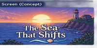

# The Day the Sea Recedes

A short 2D top-down atmospheric coastal adventure with GBA-inspired pixel aesthetics, created for **GitHub Game Off 2026**. Explore an ancient shoreline, uncover the truth behind the ocean's retreat, and guide your village to safety before the tide returns.



---

## About

In a quiet cliffside village, the Great Receding has begun—a rare occurrence where the ocean draws back miles beyond the horizon, leaving an eerie, silent seabed exposed. You play as Sens, a young villager descending to investigate the newly uncovered sands.

Built around the Game Off 2026 theme **SHIFT**, the game explores how a dramatic environmental shift uncovers forgotten history, shifting a town's ancient celebration into an urgent call to action.

---

## How to Play

Follow the narrative loop:
1. **Explore**: Walk through the village and descend the cliffside ladder onto the exposed ocean floor.
2. **Investigate Environmental Signs**: Observe unusual anomalies across the seabed, from humming shells to drained pools.
3. **Discover Clues**: Explore an ancient shipwreck to uncover historical records of past cycles.
4. **Understand What Is Happening**: Realize what the receding sea truly foretells.
5. **Return to Town**: Sound the alarm at the Town Hall and warn the council.
6. **Reach Safety**: Guide the evacuation and climb to the high-ground cliffs before the surge strikes.

---

## Controls

| Key | Action |
| :--- | :--- |
| **WASD** / **Arrow Keys** | Move |
| **E** / **Space** | Interact / Advance dialogue |
| **Enter** / **Space** | Start game / Confirm |

---

## Running the Game

### Prerequisites
- **Godot Engine 4.7.2** (or compatible Godot 4.x) with Forward+ or Mobile renderer support.

### Running from the Godot Editor
1. Install Godot 4.7.2 from [godotengine.org](https://godotengine.org).
2. Clone this repository:
   ```bash
   git clone https://github.com/pwnkxoxo/the-day-the-sea-recedes.git
   ```
3. Open Godot, click **Import**, select `project.godot` inside the cloned folder, and choose **Import & Edit**.
4. Press **F5** (or the **Play** button in the top right) to launch the game.

### Running from the Command Line
From the project root:
```bash
godot --path .
```

---

## Linux

On Linux, the project can be launched directly with the Godot binary or exported to a standalone executable via the configured Linux/X11 export preset (`export_presets.cfg`):
```bash
godot --headless --export-release "Linux/X11" builds/linux/the-day-the-sea-recedes.x86_64
```

---

## Web

A Web export preset is configured in `export_presets.cfg` and can be built using Godot's Web export template:
```bash
godot --headless --export-release "Web" builds/web/index.html
```

---

## Credits

- **Pawan** — Design, Narrative & Engineering
- **Sunjan** — Design, Narrative & Testing

---

## Assets & Attribution

- **Kenney Monochrome Pirates** by Kenney & Fleur Keijsers — Dedicated to the public domain under **Creative Commons CC0 1.0 Universal**.
- **Visual Assets**: Original pixel art by the development team.
- **Audio**: Custom synthesized 16-bit 22kHz coastal soundscapes and effects.
